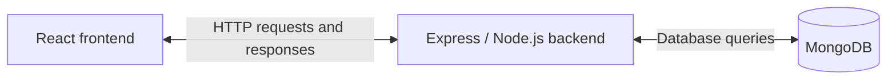

# OweBro | WiDS 6.0 — Week 1

**Learn by building. Improve by thinking.**

Welcome to our four-week collaborative full-stack MERN development project. Instead of following a tutorial to reproduce a predefined application, you will explore an existing expense-sharing codebase, identify shortcomings, debug problems and propose your own improvements.

## Start here

**[Original OweBro application repository](https://github.com/vipul-LLM/Owebro)**

This learning repository contains guidance and resources. Clone or fork the original application repository to work on its code. You are not expected to know the whole MERN stack beforehand. Use the learning resources when you encounter unfamiliar concepts, and seek mentor guidance when blocked.

## Week 1 — Explore, understand and think

| Day | Focus | Practical outcome |
|---|---|---|
| 1 | Git and GitHub | Clone or fork and create a personal branch |
| 2 | Local setup | Start frontend and backend |
| 3 | Frontend | Explore React components, routing and styling |
| 4 | Backend | Trace routes, controllers and API calls |
| 5 | Database and authentication | Understand data flow and test a request |
| 6 | Debugging | Explore available features, reproduce issues and investigate |
| 7 | Independent ideation | Propose one frontend and one backend improvement |

## Resources

- [Local setup and debugging guide](Week-1/Setup-Guide.md)
- [Learning resources and video references](Week-1/Learning-Resources.md)
- [Week 1 assignment](Week-1/Assignment.md)
- [Submission template](Week-1/Submission-Template.md)
- [Collaboration guidelines](CONTRIBUTING.md)

## How the application fits together

## Four-week journey

- Week 1: Explore the codebase, investigate problems and propose improvements.
- Week 2: Implement one meaningful frontend improvement.
- Week 3: Implement one meaningful backend improvement.
- Week 4: Integrate, test and collaboratively deploy the complete application.

There is no prescribed list of features to implement. Your observations, reasoning, experimentation and quality of contributions matter more than feature count. Keep a record of your debugging attempts and use dummy data in development.

**Week 1 outcome:** A local setup (or documented blockers), an architecture explanation, evidence of independent debugging and two well-reasoned improvement proposals.
